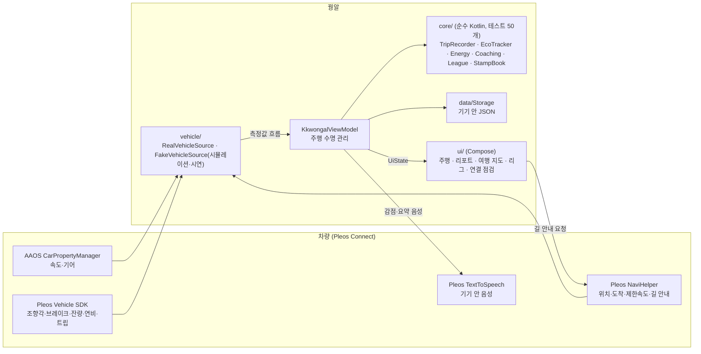

# 꿩알 — 주행 점수 · 탐험 스탬프 · 주간 리그

현대자동차그룹 차량용 앱 개발 공모전용 시제품 코드입니다.
주행이 끝나면 점수를 보여 주고, 처음 가 본 장소에 스탬프를 찍어 나만의 여행 지도를 만들며, 매주 평균 점수로 순위를 겨룹니다.

## 주요 기능 (구현됨)

기획서의 핵심 흐름인 "잘 운전하면 점수 → 새로운 곳에 가면 스탬프 → 주간 순위 → 리워드"를 처음부터 끝까지 구현했습니다.

1. **주행 점수**: 주행이 끝나면 종합 점수(0~100)를 보여 줍니다.
   - 안전 점수 (40%): 속도 변화로 급가속·급제동을, 핸들 각도 변화로 급조향을 세고 10km당 감점으로 환산
     - 급가속·급제동 기준은 한국교통안전공단 위험운전행동 기준(초당 11km/h 이상 가속·감속, 약 0.3g)을 따름
     - 감점: 급출발 4점, 급정거 5점, 급조향 4점. 10km 이하 주행은 이 감점 그대로, 더 긴 주행은 달린 거리만큼 나눠 점수가 서서히 회복됨
   - 주행 중 화면: 종합 점수(에코 60% + 안전 40%) 원형 게이지와 숫자 하나만 보여 줌. 운전자의 시선을 빼앗지 않도록 감점 내용은 화면에 띄우지 않음
   - 감점 음성 안내: 감점 순간 "급정거, 5점 감점"처럼 음성으로 알려 줌. 홈 설정에서 켜고 끌 수 있음(기본 켜짐)
     - Pleos Gleo AI TextToSpeech SDK 3.3.1 의 기기 안 엔진(ON_DEVICE)을 쓰므로 인터넷·앱 키가 필요 없음. 쓸 수 없으면 안드로이드 기본 음성으로 대체
   - 주행 코칭: 리포트에 "평소보다 에코 +6점"(내 최근 5번 평균과 비교)과 가장 아쉬운 습관 한 가지 조언. 주차하면 "주행 끝. 종합 82점이에요. 에코는 평소보다 6점 높아요. 공회전이 아쉬웠어요."처럼 한 줄 요약을 읽어 줌(음성 안내 설정을 따름)
   - 주행 리포트에 감점 기록 목록(시각·몇 km 지점·무엇·몇 점·남은 점수)과 주행 흐름 막대
   - 에코 점수 (60%): 다섯 가지 운전 습관 점수를 비중대로 합친 값에, 실제 연비(전비)를 내 평소 기록과 비교한 결과를 반반 섞음
     - 부드러운 가속 (40%): 1m 를 가는 동안 속도를 올리는 데 쓴 에너지
     - 정속 주행 (20%): 시속 60km 이상 구간에서 1초마다 속도가 얼마나 오르내렸는지. 정속 구간이 1분 넘을 때만
     - 적정 속도 (15%): 내비가 알려 준 제한속도보다 10km/h 넘게 빨리 달린 거리 비율. 제한속도를 모르면 시속 110km 기준
     - 미리 감속 (15%): 속도를 줄인 양 중 브레이크를 밟지 않고(발을 떼고) 줄인 비율. 브레이크 페달 신호를 받을 때만
     - 공회전 (10%): 한 번에 2분 넘게 서 있던 시간 (2분까지는 신호 대기로 봄)
     - 매기지 못한 항목은 빼고 나머지 비중으로 나눔. 리포트에 항목별 점수와 가장 아쉬운 항목 한 가지 조언을 보여 줌
   - 도로 종류: 내비가 1초마다 알려 주는 제한속도(Pleos NaviHelper `onCurrentRoadSpeedLimit`)로 나눔. 90 이상 고속도로(자동차전용도로 포함), 60~80 국도, 50 이하 시내. 제한속도를 받은 거리가 절반이 안 되면 평균 속도로 추정
     - 연비 비교의 평소 기록은 같은 도로 종류의 최근 10번 중앙값. 고속도로 주행이라서 연비가 좋게 나오는 것을 막음
   - 실제 연비(전비): 출발과 도착 때 연료·배터리 잔량과 누적 주행거리를 읽어 계산. 결과 화면에 "실제 전비 5.0 km/kWh · 평소보다 8% 좋아요"처럼 표시
2. **탐험 스탬프**: 주차했을 때 위치가 기존 스탬프에서 500m 이상 떨어져 있으면 새 스탬프
   - 장소 이름 자동 입력: 내비가 알려 준 목적지 이름(예: 강릉 안목해변)을 쓰고, 없으면 현재 위치 주소를 씀
   - 스탬프 기록: 장소 이름, 태그(주차가 편해요, 가는 길이 예뻐요 등 6종), 한마디를 남김. 태그는 한 번 눌러 고르고, 여행 지도 탭에서 나중에 고칠 수 있음
3. **나만의 여행 지도**: 확대·이동이 되는 실제 지도(오픈스트리트맵) 위에 스탬프를 표시. 인터넷이 없을 때는 앱에 내장된 대한민국 윤곽 지도로 바꿔 볼 수 있음
4. **배지**: 첫 스탬프, 스탬프 5개, 90점 이상 3회, 무결점 주행
5. **주간 리그**: 한 주(월요일 시작)의 평균 점수로 순위를 매김. 거리 합계가 아니라 평균이라 많이 달린다고 점수가 오르지는 않음
   - 공정성: 1km 미만 주행은 리그에 넣지 않음(주차장에서 짧게 움직여 만점을 쌓는 꼼수 방지). 기록이 짧으면 80점 쪽으로 보정. 시뮬레이션 기록과 실제 주행 기록은 서로 다른 리그
   - 평균은 주행 거리만큼 비중을 두고, 기록이 짧으면 80점 쪽으로 보정(20km를 80점으로 달린 것처럼 섞음). 짧은 주행 한 번의 만점으로 1위가 되지 않음
7. **주행 기록 보호**
   - 진행 중인 주행을 30초마다, 그리고 감점이 생길 때마다 저장. 앱이 꺼졌다 켜졌을 때 차가 달리는 중이면(10분 이내) 이어서 기록하고, 이미 주차돼 있으면 그때까지의 주행을 기록으로 남김
   - 주차 후 3분 안에 같은 자리(300m 이내)에서 다시 출발하면(주유, 짐 싣기, 주차 자리 옮기기) 앞 주행에 이어 붙임. 그 정차 때 자동으로 찍힌 알은, 이름·한마디·태그를 직접 고치지 않았다면 지움
8. **차량 연결 점검**: 홈의 `점검하기`에서 속도, 기어, 핸들 각도, 위치, 목적지 도착, 연료·배터리, 주행 중 화면 제한이 들어오는지와 마지막 값을 보여 줌. 못 받는 값은 앱이 어떻게 달라지는지 함께 안내
   - 기어 값을 10초 안에 못 받으면 속도로 출발(시속 5km 이상)과 주차(2분 넘게 정지)를 판단
6. **리워드 포인트**: 주간 순위에 따라 상위 10% 500P, 상위 30% 200P, 그 외 50P

시뮬레이션 모드가 있어 차나 Pleos 에뮬레이터 없이도 화면의 조작 패널로 전체 흐름을 확인할 수 있습니다.

## 시연용으로 단순화한 것

- **리그의 다른 운전자는 가상 데이터입니다.** 서버가 없어 주마다 고정된 가상 운전자 19명과 비교합니다. 실제 서비스에서는 `core/League.kt`의 `rivals()`를 서버 응답으로 바꿉니다.
- **포인트는 앱 안의 가상 포인트입니다.** 실제 멤버십 포인트 지급은 현대자동차그룹과의 연계가 필요한 제안 사항입니다.
- **시뮬레이션 모드의 차는 가상 전기차입니다.** 배터리 72kWh에서 시작해, 달린 거리와 가속에 쓴 에너지만큼 줄어듭니다. 가다 서다를 반복하면 전비가 눈에 띄게 나빠집니다.
- **실제 연비는 평소 기록이 2번 쌓인 뒤부터 점수에 반영됩니다.** 그 전에는 측정값만 보여 줍니다. 내연기관차는 연료 잔량이 1% 단위라 짧은 주행에서는 측정하지 않습니다.

## 아직 안 된 것

- 비슷한 조건끼리 나누는 리그 구분 (전기차/내연기관차 등). 지금은 에코 점수의 실제 연비 부분을 내 평소 기록과만 비교해 차종 차이를 줄입니다
- 스탬프 기록 공유: 태그와 한마디는 기기 안에만 저장되고 다른 사용자에게 보이지 않습니다

## 실행 방법

1. Android Studio에서 이 폴더를 엽니다 (File > Open). JDK 17이 필요합니다.
2. Gradle 동기화가 끝날 때까지 기다립니다. Pleos SDK는 `settings.gradle.kts`에 적힌 저장소에서 내려받습니다.
3. 실행 대상에 따라:
   - **차 없이 바로 보기**: 일반 안드로이드 에뮬레이터나 휴대폰에서 실행하면 자동으로 시뮬레이션 모드가 됩니다.
   - **Pleos Connect 에뮬레이터**: 공식 가이드대로 에뮬레이터를 설치한 뒤 실행합니다. 처음 실행할 때 속도 읽기 권한을 허용해야 합니다.
4. 발표 시연: 시뮬레이션 패널의 `시연 시작`을 누르면 정해진 시나리오로 출발부터 주차까지 자동으로 달립니다 (5배속, 약 1분 30초). 시내 출발 → 급출발 1회 → 국도 정속 → 고속도로 정속 → 과속(리포트 조언이 "적정 속도"로 나오도록) → 발 떼고 미리 감속 → 급정거 1회 → 오래 정차(공회전) → 강릉 안목해변 도착. 매번 같은 흐름이라 감점 음성, 에코 습관 카드, 도로 종류, 알 획득, 리그를 한 번에 보여 줄 수 있습니다. 5배속이라 리포트의 주행 시간은 실제 흐른 시간(1~2분)으로 나옵니다.
5. 시뮬레이션 모드에서 직접 해 보기: `서울` 같은 위치 버튼 → `출발 (D)` → 슬라이더로 속도 조절, `+30` / `−30` → 20초쯤 달린 뒤 `주차 (P)`. 300m 미만 주행은 기록하지 않습니다. 결과 화면에서 점수와 스탬프, 리그 순위를 확인하고 `주간 리그` 탭에서 순위표를 봅니다. 순위에 오르려면 그 주에 1km 이상 달려야 합니다.

## 검증 상태

- 점수 계산(주행 중 종합 점수 포함), 스탬프 판정, 주간 리그, 급조향, 브레이크 페달 판정, 실제 연비(차량 계산값 대체 포함), 주행 이어 붙이기, 기어 대체 판단, 에코 습관 항목, 제한속도 도로 구분, 리그 공정성, 코칭 문구(`core` 폴더)은 테스트 50개를 실행해 모두 통과했습니다. Android Studio에서는 `./gradlew test`로 다시 돌릴 수 있습니다.
- 전체 앱을 Pleos Connect 에뮬레이터 v2.1.0(Android 14)에서 빌드·설치·실행해 확인했습니다 (2026-11-16).
  - 차량 연결 점검 화면에서 속도·기어(표준 API), 핸들 각도·브레이크 페달(Pleos Vehicle SDK 리스너), 내비 연동(Pleos NaviHelper)이 "연결됨"으로 들어오는 것을 확인했습니다.
  - 시뮬레이션 주행으로 주행 화면(감점 기록 막대), 리포트(도착지 이름 자동 입력, 리그 순위), 앱 재설치 중 끊긴 주행의 복구를 확인했습니다.
  - 감점 음성 안내: 에뮬레이터에서 Pleos Gleo 음성이 초기화되고, 시뮬레이션 감점 때 음성 서비스가 재생 완료(onDone)를 보내는 것을 로그로 확인했습니다 (2026-11-17).
- 아직 확인하지 못한 것: 실제 차량에서의 값, 에뮬레이터에서 목적지 도착 이름과 내비 길 안내(requestRoute) 동작.

## 구조



- 차량에서 오는 값은 모두 `VehicleSource` 하나의 모양으로 들어옵니다. 실제 차량과 시뮬레이션이 같은 모양이라 나머지 코드는 둘을 구분하지 않습니다.
- 점수·리그·코칭 계산은 안드로이드와 무관한 `core`에 모아 차 없이도 테스트할 수 있습니다.

## 폴더 구조

```
app/src/main/java/com/kkwongal/drive/
  core/      점수·스탬프·배지·주간 리그 계산 (안드로이드와 무관한 순수 코드)
  vehicle/   차량 데이터 입력: 실제 차량, 시뮬레이션, Pleos 내비 연동
  data/      기기 내 저장 (JSON 파일)
  KkwongalViewModel.kt   주행 시작·이어 가기·종료 처리, 기록 저장, 코칭 음성
  UiState.kt           화면이 그리는 상태
  ui/                  화면 (Jetpack Compose): 테마, 주행 중, 리포트, 여행 지도, 홈·리그, 연결 점검
  voice/               감점 음성 안내 (Pleos TextToSpeech)
  MainActivity.kt      화면 전환
app/src/test/          core 테스트
```

## 조정할 값

- 급가속·급제동 기준과 감점, 감점 환산 최소 거리(10km), 에코 점수 기준, 에코·안전 비율(에코 60%·안전 40%): `core/TripRecorder.kt`의 `ScoreConfig`
- 리그 인원, 최소 주행 거리, 짧은 기록 보정(80점·20km), 리워드 포인트: `core/League.kt`의 `LeagueConfig`
- 주행 이어 붙이기 시간·거리, 앱 재시작 복구 시간: `core/TripContinuation.kt`의 `TripContinuation`
- 기어 값이 없을 때 출발·주차 판단 기준: `core/Diagnostics.kt`의 `SpeedDriveDetector`
- 도로 종류 구분 제한속도(90 이상 고속도로, 60 이상 국도)와 평균 속도 대체 기준(시내 30km/h 미만, 고속도로 65km/h 이상): `core/Models.kt`의 `RoadType`
- 에코 습관 항목 기준과 비중(정속·적정 속도·미리 감속·공회전): `core/EcoHabits.kt`의 `EcoConfig`
- 새 장소로 보는 거리: `core/StampBook.kt`의 `newPlaceRadiusM` (500m)
- 기록하는 최소 주행 거리: `KkwongalViewModel.kt`의 `MIN_TRIP_KM` (0.3km)
- 배지 조건: `core/StampBook.kt`의 `BadgeRules`
- 스탬프 태그 종류: `core/Models.kt`의 `StampTags`
- 급조향 기준 (1초에 60도, 시속 30km 이상): `core/TripRecorder.kt`의 `ScoreConfig`
- 실제 연비 측정 최소 조건, 평소 대비 점수 환산: `core/Energy.kt`의 `EnergyMeter`

## 차량 데이터 출처

Pleos 공식 정책("표준 우선")에 따라, 안드로이드 차량용 표준에 있는 값(속도·기어·연료 탱크 용량)은 표준 API로, 표준에 없는 값은 Pleos SDK로 읽습니다. 차종마다 지원 API가 달라서, Pleos 값은 쓰기 전에 `check...Capabilities`로 지원 여부를 먼저 확인합니다.

| 데이터 | 읽는 방법 | 쓰는 곳 | 권한 |
| --- | --- | --- | --- |
| 속도 | 표준 `PERF_VEHICLE_SPEED` | 점수, 거리 | `android.car.permission.CAR_SPEED` |
| 기어 | 표준 `GEAR_SELECTION` | 주행 시작·끝 | `android.car.permission.CAR_POWERTRAIN` |
| 주행 중 화면 제한 | `CarUxRestrictionsManager` | 주행 중 조작 막기 | 없음 |
| 연료 탱크 용량 | 표준 `INFO_FUEL_CAPACITY` | 실제 연비 | `android.car.permission.CAR_INFO` |
| 조향각 | Pleos Vehicle `registerSteeringWheelAngle` (리스너) | 급조향 | `pleos.car.permission.CAR_DRIVE` |
| 브레이크 페달 | Pleos Vehicle `registerBrakePedalStatus` (리스너) | 급정거 판정 (공단 기준: 브레이크를 밟으며 감속) | `pleos.car.permission.CAR_DRIVE` |
| 연료·배터리 잔량, 누적 주행거리 | Pleos Vehicle `getFuelPercent`, `getEvBatteryLevel`, `getCurrentDistanceDriven` | 실제 연비 | `pleos.car.permission.CAR_ENERGY`, `CAR_MILEAGE` |
| 차량 계산 이번 주행 전비·연비 | Pleos Vehicle `getCurrentEvEfficiency`, `getCurrentFuelEconomy` | 잔량으로 잴 수 없을 때의 실제 연비 | `pleos.car.permission.CAR_ENERGY` |
| 차량 트립 거리·시간 | Pleos Vehicle `getTripCurrentDrivingDistance`, `getTripCurrentDrivingTime` | 연결 점검 화면 | `pleos.car.permission.CAR_DRIVE` |
| 지원 여부 | Pleos Vehicle `check...Capabilities` | 연결 점검 화면 | 항목별 |
| 현재 위치·주소, 목적지 도착·이름 | Pleos NaviHelper `onCurrentLocationInfo`, `onDestinationArrived` | 알(스탬프) 위치와 이름 | `pleos.car.permission.NAVI_ROUTE` |
| 지금 도로의 제한속도 (1초마다) | Pleos NaviHelper `onCurrentRoadSpeedLimit` | 도로 종류 구분, 에코 "적정 속도" | `pleos.car.permission.NAVI_ROUTE` |
| 길 안내 시작 | Pleos NaviHelper `requestRoute` | 여행 지도의 "길 안내" 버튼 | `pleos.car.permission.NAVI_ROUTE_SEARCH` |
| 음성 합성 | Pleos TextToSpeech 3.3.1 (`Mode.ON_DEVICE`, `initialize`, `setLocale`, `speak`) | 감점 음성 안내 | `pleos.car.permission.TTS_SERVICE` |

- Pleos 조향각 API는 핸들 회전각이 아니라 **앞바퀴 조향각**을 줍니다(SDK 설명). 급조향 기준은 핸들 회전 속도로 정해 두었으므로, 일반 승용차 조향비(약 15:1)로 환산해 씁니다 (`PleosVehicle.STEERING_RATIO`).

## 디자인 가이드 반영 (Pleos Connect UI Design Guide)

- 글꼴: 가이드 권장 글꼴 Asta Sans(42dot, SIL Open Font License, `AstaSans-OFL.txt`)
- 글자 크기: 17인치 차량 화면에서 재어 보조 글자 3mm 이상, 중요 숫자 5mm 이상이 되도록 차량 화면에서 글자를 25% 키움. 최소 12sp
- 대비: 모든 글자·배경 조합 4.5:1 이상 (밝은 화면의 빨강·초록을 더 진하게 조정)
- 주행 중 움직임 없음: 감점 기록이 밀려 들어오거나 깜빡이지 않고, 게이지도 바로 바뀜
- 터치 피드백: 모든 버튼·태그·탭·카드에 진동(햅틱)과 눌림 효과
- 야간 모드: 차량의 주간·야간 모드를 자동으로 따름 (설정에서 밝게·어둡게 고정 가능)

## 지도 데이터 출처

- 실제 지도: OpenStreetMap (© OpenStreetMap contributors), osmdroid 라이브러리로 표시. 인터넷 연결 필요
- 윤곽 지도: Natural Earth 1:10m Admin 0 Countries (퍼블릭 도메인)

## 개발·검증 안내

- [Android 빌드와 소스 위치](docs/BUILD.md)
- [실제 SDK 콜백 진단](docs/SDK_RUNTIME_CHECK.md)
- [스탬프 자동 이름 검증](docs/STAMP_NAMES.md)
- [선택적 개발 서버 리그 연결과 API 계약](backend/README.md)

서버 주소를 설정하지 않으면 위에서 설명한 시연용 가상 리그를 사용합니다.
주소를 설정한 빌드는 명시적으로 전송한 사용자 기록으로 서버 순위를 조회합니다.
실제 주행과 시뮬레이션은 각각 별도 리그이며 포인트는 계속 개발용 가상 포인트입니다.
